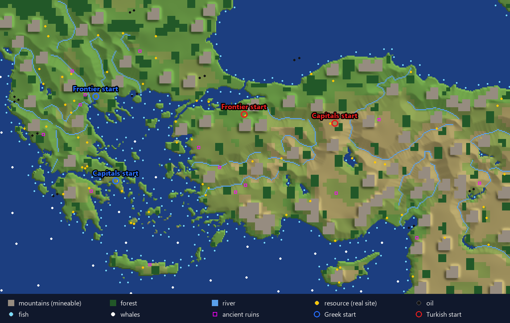
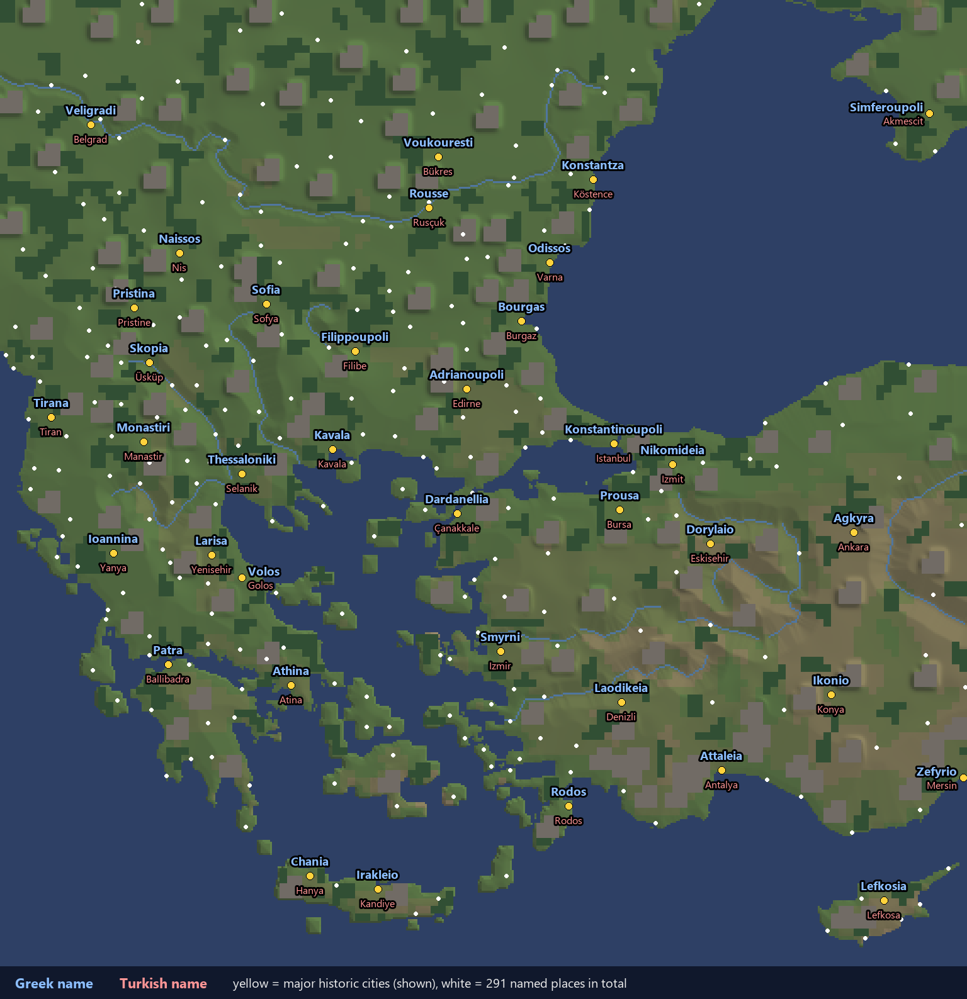
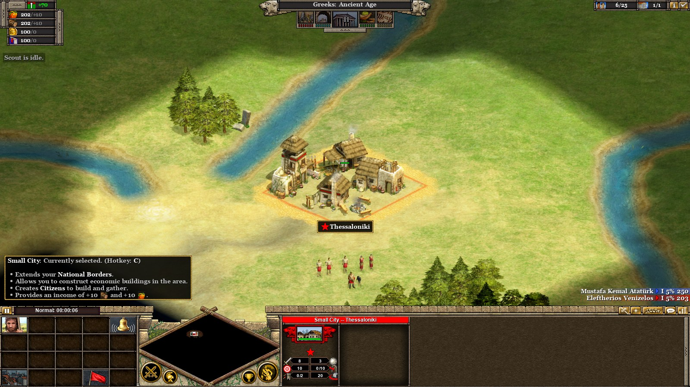
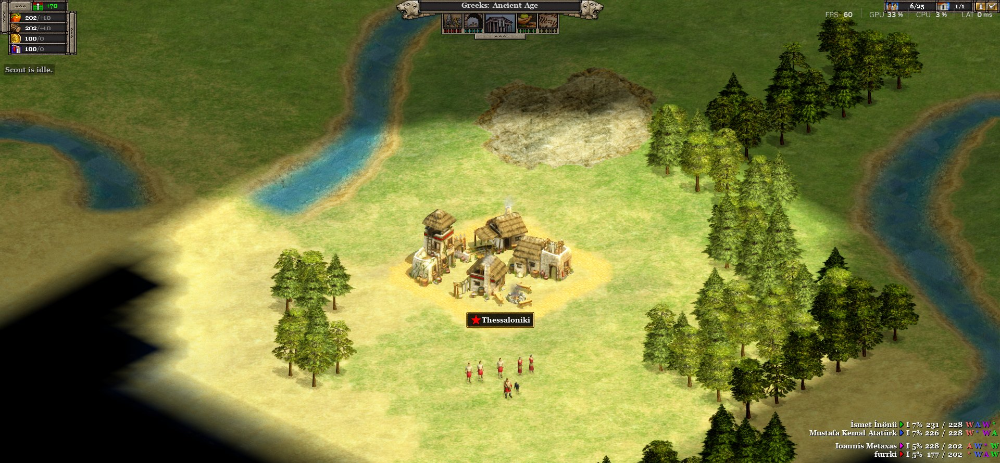
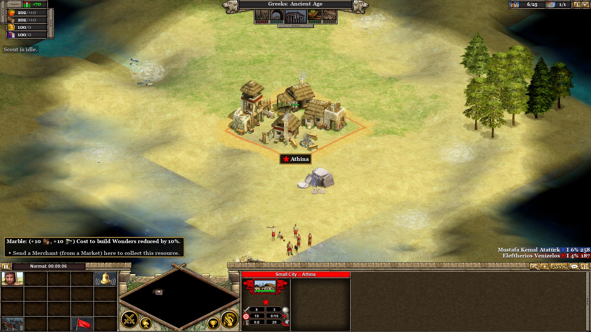
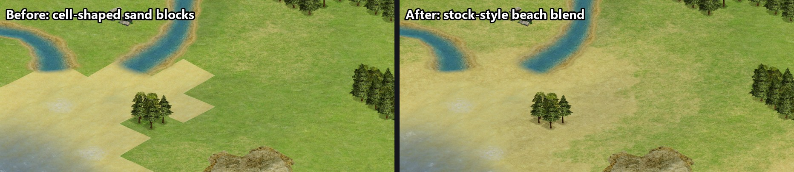
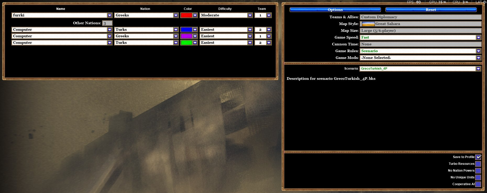
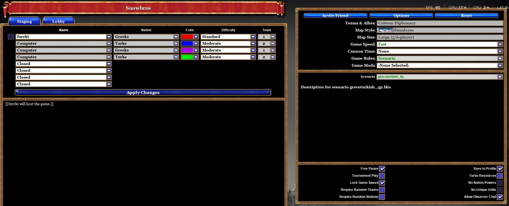
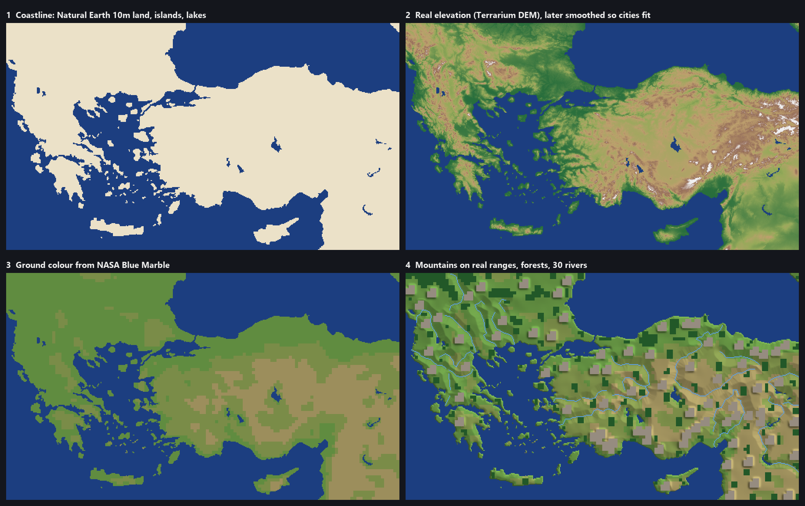

# Greco-Turkish War: a real-geography map for Rise of Nations: Extended Edition

A two-player map, Greeks vs Turks, built from real geodata. It covers:
- Greece and the Aegean islands
- western and central Turkey, as far as Ankara, Konya and Antalya
- Cyprus
- the Balkans north to the Danube and beyond (Albania, North Macedonia, Bulgaria, Serbia, southern Romania)
- western Crimea

Every city you found takes the name of the nearest real place, in your own language.

**Steam Workshop:** [Greco-Turkish War](https://steamcommunity.com/sharedfiles/filedetails/?id=3822466863). Subscribe and the
game installs it for you; it's also what makes online multiplayer work.



## Features
- **Real map, made for play:**
  - 512×512 tiles at about 2.6 km per tile.
  - Coastline and islands come from Natural Earth 10m data, with the Bosphorus, Dardanelles and Gulf of Corinth open.
  - Greece's coasts and islands are widened by about 5 km, so Greece has room to grow.
  - Narrow inlets are filled in, and there are no inland lakes.
- **Smooth, stock-style coasts:** sand beaches blend into dirt and grass the way they do on the game's own maps
  (see [How it works](#how-it-works)).
- **9 major rivers:** Danube, Evros/Meriç, Axios/Vardar, Strymonas, Haliacmon, Sakarya, Kızılırmak, Gediz and
  Büyük Menderes.
- **Mountains on the real ranges** (Pindus, Rhodopes, Balkan, Taurus…), plus mineable outcrops near the towns.
- **Organic forests** placed from NASA Blue Marble imagery.
- **Playable starts:** every start city and every big historic city (38 in all) gets:
  - a clear ring for the city and its farms;
  - a wood about 8–12 tiles out;
  - a mineable rock on another side.
- **516 resources at real sites:** Penteli marble, Ploiești oil, Bor copper, Crimean salt, wine, olive oil, silk,
  fish, whales and more. There are also 17 ancient-ruin goody boxes.
- **City names:** a scenario script renames each new city to the nearest of 291 real places, in the founder's language:

  | | Greek player | Turkish player |
  |---|---|---|
  | Athens | Athina | Atina |
  | Thessaloniki | Thessaloniki | Selanik |
  | Istanbul | Konstantinoupoli | Istanbul |
  | Izmir | Smyrni | Izmir |
  | Bucharest | Voukouresti | Bükres |

  Big historic cities claim their name from further away. A captured city takes the captor's name for it.



## Screenshots
**Frontier:** the Greek start at Thessaloniki, with farms, a woodcutter's camp, a mineable rock and the beach.


**4 players:** you and 3 bots, with every capital named and the Greek and Turkish teams set on the setup screen.


**Capitals:** the Athens start, with a mineable rock to the north, woods on three sides and Penteli marble.


**Coast rendering:** before and after matching the stock-map texture rules.


## Scenarios
| Scenario | Players | Default slots (slot: nation, start city, team) |
|---|---|---|
| `GrecoTurkish_Frontier` | 2 | 1: Greeks, Thessaloniki · 2: Turks, Bursa. A faster clash around Thrace and the Marmara |
| `GrecoTurkish_Capitals` | 2 | 1: Greeks, Athens · 2: Turks, Ankara. A long build-up |
| `GrecoTurkish_4P` | 4 | Frontier and Capitals starts together: Greeks (team 1) vs Turks (team 2) |
| `GrecoTurkish_6P` | 6 | 4P plus Greeks at Sofia and Turks at Konya |

Each player starts in the Ancient Age with a Small City, 5 Citizens and a Scout. The game runs up to the
Information Age. A player without cities is out, and the game ends when everyone left is allied.

## What you can set on the setup screen
These scenarios let the setup screen override them, so in **Quick Battle** or a **multiplayer lobby** you choose:
- **who plays each slot:** you, a friend, or a bot (**Computer**, **Computer/Rush** or **Computer/Boom**) with its own
  **difficulty**;
- **nation, color and team** for every slot. The defaults are Greeks vs Turks; any nation works;
- **game speed**, **Turbo Resources**, **No Nation Powers**, **No Unique Units** and **Cooperative AI**.

The number of players comes from the scenario you pick (2, 4 or 6), and every slot must be filled, by a human or a
bot. Map, start age, end age and victory rules come from the scenario.

Cities get Turkish names for a Turks player and Greek-side names for any other nation.

## Install
**Recommended: Steam Workshop.** Subscribe to [Greco-Turkish War](https://steamcommunity.com/sharedfiles/filedetails/?id=3822466863)
and restart the game. Steam keeps it up to date, and online games need the Workshop version.

**Manual (solo only):** download the zip from [Releases](../../releases) and extract it into the game's
`scenario\Custom\` folder (Steam → Rise of Nations → ⚙ → Manage → **Browse local files**).

## Play against bots
1. **Solo Game → Quick Battle.** This opens the setup screen.
2. Set **Game Rules: Scenario** and pick a scenario under **Scenario**: `custom\grecoturkish_frontier\...`,
   `..._capitals`, `..._4p` or `..._6p`.
3. Slot 1 is you. Set the other slots to **Computer** and pick their difficulty, nation and team.
4. Press **Start**.



## Play with a friend online, with or without bots
This runs on the game's own online lobby through Steam. You don't need Hamachi or a shared network.
1. Both players subscribe to the [Workshop item](https://steamcommunity.com/sharedfiles/filedetails/?id=3822466863)
   and update the game.
2. The host goes to **Multiplayer Game → Game Browser → Create**. Set Max Players to the scenario's size and
   Visibility to **Private**.
3. In the lobby, set **Game Rules: Scenario** and pick the scenario.
4. Press **Invite Friend** and invite your friend through Steam. Set the remaining slots to **Computer** for bots, and
   use the Team column to play together against them (for example, both of you on team 1 in `4P`).
5. Press **Start**. Within about 2 seconds every capital gets its real name.



Online play needs the Workshop version: the game refuses unpublished scenarios in multiplayer ("You must publish your
scenario before you can play it in a multiplayer game"). It also needs at least 2 human slots in the file; every slot
in these scenarios is human by default.

## Saving and resuming
- **Game Menu (Esc) → Save Game** at any time; **Load Game** resumes it. Saves are in
  `Documents\My Games\Rise of Nations\Saves`.
- The game also keeps autosaves in the **AutoSaves** folder of the same dialog, so a crash or disconnect costs a few
  minutes at most.
- The map script is save-safe. After loading, the start setup doesn't run again, and naming continues: tested by
  saving, loading and founding a new city, which got its real name (Kavala).
- In multiplayer, the host saves; to resume, the same players load the save from the multiplayer setup.

## Rebuild or tweak the map
The `generator/` folder holds the full pipeline. It needs Python 3 (tested with 3.14) on Windows with the game
installed, because it reads a few stock scenario records as templates.



```bat
cd generator
pip install -r requirements.txt
python fetch_data.py            :: ~30 MB of open geodata into generator\data (follows the map extent)
python tools\build.py           :: writes the 4 scenarios to generator\out\
python tools\build.py --install :: ...and copies them into the game's scenario\Custom folder
python tools\build.py --mod     :: ...or into mods\GrecoTurkishWar, then re-publish from the in-game Mod Manager
```
If Steam put the game somewhere else, set `RON_DIR` first, e.g. `set RON_DIR=D:\SteamLibrary\steamapps\common\Rise of Nations`.

The build is deterministic: the same code and data always produce the same `.scx` files.

| To change | Edit |
|---|---|
| City names, coordinates, which cities are "major", start cities | `tools/cities.py` |
| Resource sites, oil fields, ruins | `tools/resources.py` |
| Which rivers are drawn | `RIVERS` / `HAND_RIVERS` in `tools/features.py` |
| Map extent (the north edge is computed so the map stays square) | `LON0, LON1, LAT0` in `tools/geo.py` |
| How much Greece is widened | `GROW_BOX`, `GROW_TILES` in `tools/terrain.py` |
| Start kits (clear ring, wood and metal distances) | `start_kit` in `tools/features.py` |
| Default slots (start city, nation, team) for each scenario | `STARTS` in `tools/cities.py` |
| Mountain density, leaders, nations | constants at the top of `tools/build.py` |

Other tools:
- `tools/metrics.py 512` and `tools/greece_metric.py 512`: playability reports (city spots, wood and metal near each town).
- `tools/doc_images.py`: regenerates the map images in `docs/images`.
- `tools/make_test.py`: builds a `zR_test` scenario with extra test cities for checking the naming script.
- `tools/ronscx.py`: generic reader and writer for RoN `.scx`/`.sce` chunk files.
- `tools/pdbtypes.py`: looks up struct layouts in the game's own debug symbols (`sbl\rise.pdb`).

## How it works
RoN scenarios are gzip-compressed trees of binary chunks. The generator:
1. rasterises the geodata onto a square Mercator grid;
2. widens Greece and fills small inlets;
3. writes the terrain layers: water and coast flags, vertex heights with stock-like beaches, textures, mountain
   stamps, forests and rivers;
4. places resources, ruins and the start kits;
5. writes a `.bhs` script that places the starting cities and handles the naming.

The coasts look smooth because the textures follow the rule every stock map follows:
- the 4 ground textures form a cycle, and touching cells are never opposite on it;
- the land ring along the coast is "dirt", which blends into the beach.

Breaking this rule gives cell-shaped sand blocks or a crash.

The format notes, including the engine limits that crash the game if you get them wrong, are in
[docs/FORMAT.md](docs/FORMAT.md).

## Status
- Tested in RoN: Extended Edition 1.20:
  - the scenarios load and play from the solo setup screen, with bots, edited nations and teams;
  - 4 players (you + 3 bots) start with real capital names and wood, metal and farm room;
  - saving and loading mid-game keeps the naming script working;
  - published to the Steam Workshop; a private online lobby accepts it with Game Rules: Scenario.
- Not yet tested: a full two-PC online game, renaming on capture, and the end-of-game check. Please open an issue
  if something breaks.

## Credits
- Coastlines and rivers: [Natural Earth](https://www.naturalearthdata.com/) (public domain).
- Elevation: [Terrain Tiles](https://registry.opendata.aws/terrain-tiles/) by Mapzen on AWS Open Data. They are
  derived from SRTM, GMTED2010, ETOPO1 and other sources ([attribution](https://github.com/tilezen/joerd/blob/master/docs/attribution.md)).
- Imagery: NASA Blue Marble Next Generation via [NASA GIBS](https://www.earthdata.nasa.gov/engage/open-data-services-software/earthdata-developer-portal/gibs-api).

Rise of Nations is a trademark of Microsoft. This is a fan-made map, not affiliated with or endorsed by
Microsoft or Big Huge Games. The repo contains no game files; the generator reads its templates from your own install.
